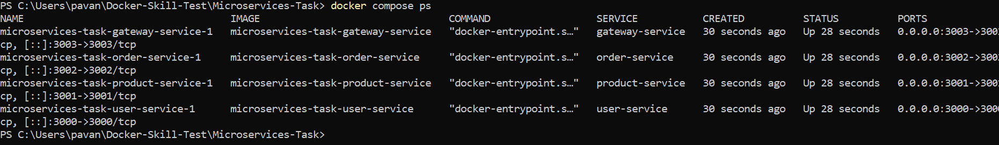
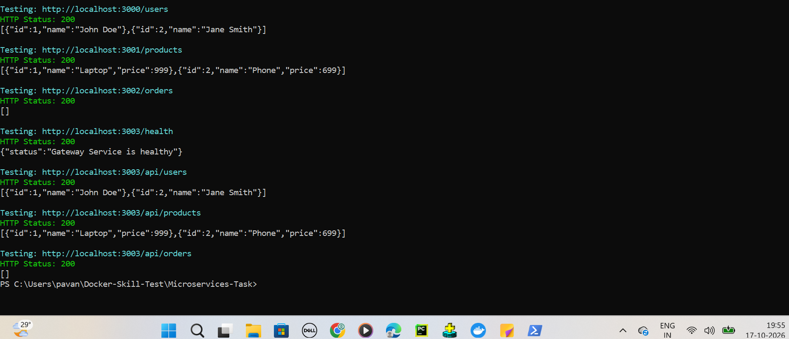
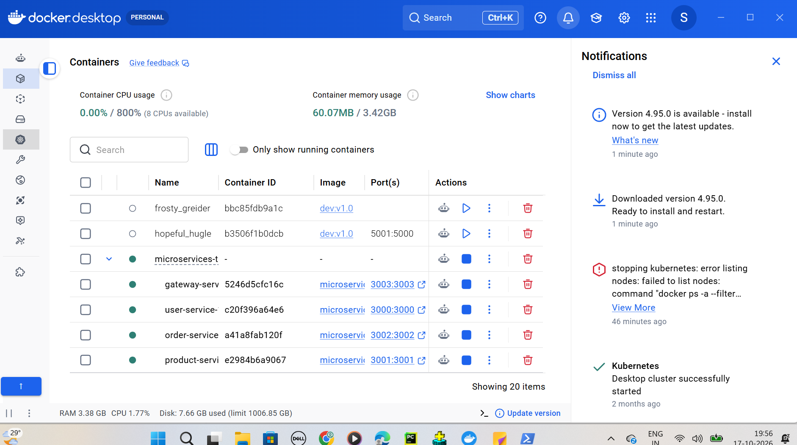

# Dockerized Node.js Microservices

## Overview
This project uses Docker and Docker Compose to containerize four Node.js microservices.

## Services

| Service | Port | Endpoint |
|---|---|---|
| User Service | 3000 | `/users` |
| Product Service | 3001 | `/products` |
| Order Service | 3002 | `/orders` |
| Gateway Service | 3003 | `/health` |

The Gateway exposes `/api/users`, `/api/products`, and `/api/orders`.

## Prerequisites
- Docker Desktop
- Docker Compose
- Git

## Setup Instructions

Clone the repository and navigate to the project directory.

Build and start all containers:

`docker compose up --build -d`

Check container status:

`docker compose ps`

View logs:

`docker compose logs`

Stop containers:

`docker compose down`

## Testing

After the containers start, test the following URLs:

- http://localhost:3000/users
- http://localhost:3001/products
- http://localhost:3002/orders
- http://localhost:3003/health
- http://localhost:3003/api/users
- http://localhost:3003/api/products
- http://localhost:3003/api/orders

## Networking

All services use the shared `microservices-network` Docker bridge network.

The Gateway communicates with backend services through their Docker DNS names.

## Troubleshooting

**Docker Engine unavailable:** Restart Docker Desktop and verify WSL2.

**Port already allocated:** Check whether ports 3000–3003 are in use.

**Container fails to start:** Run `docker compose logs <service-name>`.

**Gateway returns HTTP 500:** Check backend service availability and container logs.

## Testing Results

All four Docker images built successfully using Docker Compose.

All seven GET endpoints returned HTTP 200 during local testing.

The Gateway successfully communicated with the User, Product,
and Order services over the shared Docker network.

## Screenshots

### Running Containers

### API Testing

### Docker Desktop
